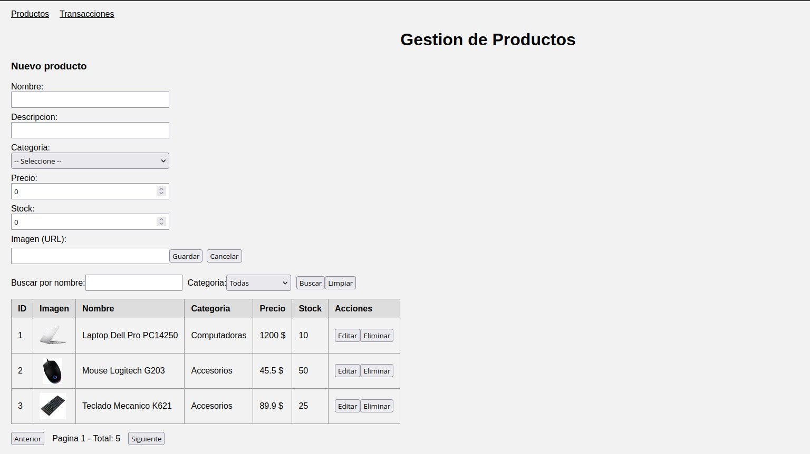
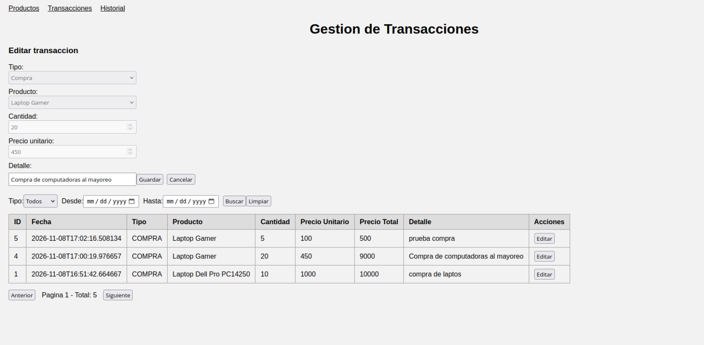
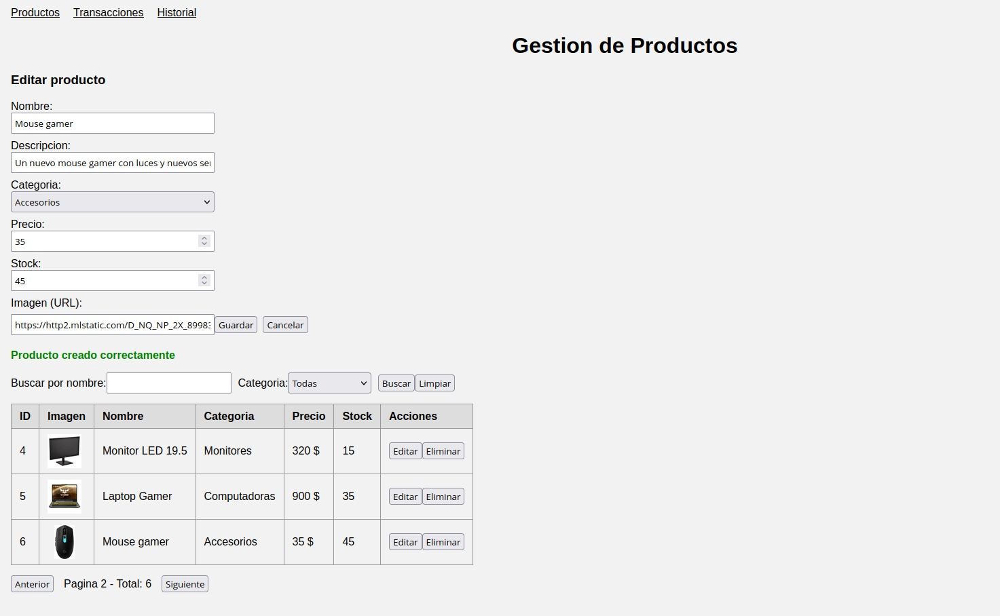
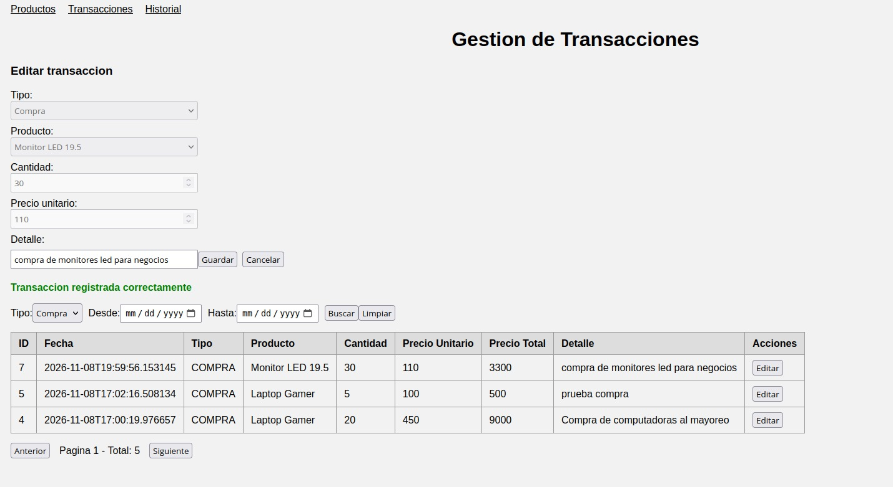
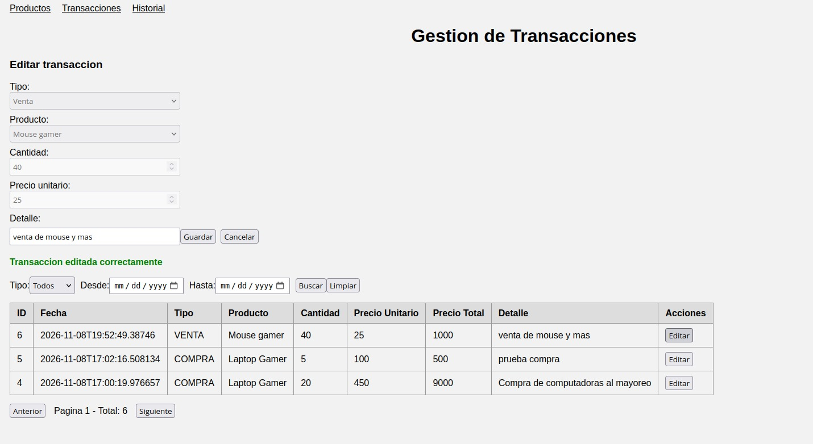
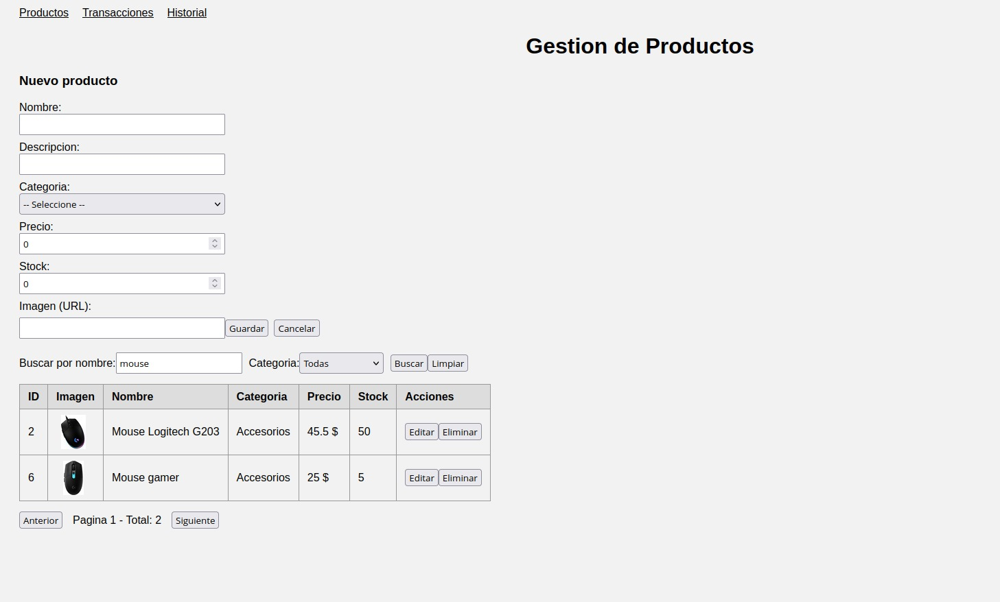
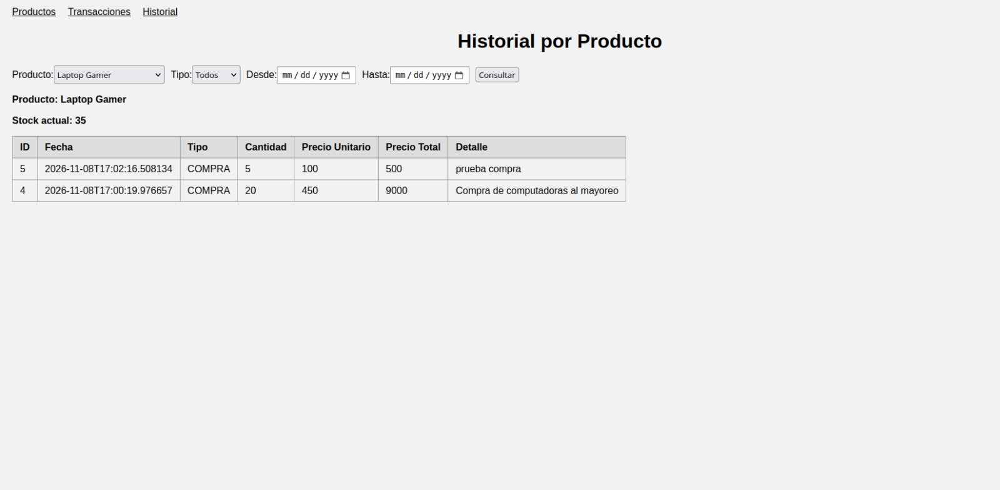

# Sistema de Gestion de Inventario

Aplicacion de gestion de inventario construida con una arquitectura de
microservicios. Permite administrar productos y registrar transacciones
(compras y ventas), ajustando el stock de forma automatica.

## Tecnologias
- Backend: .NET 10 (dos microservicios REST)
- Frontend: Angular 21
- Base de datos: PostgreSQL 16
- Docker y Docker Compose

## Arquitectura
El sistema tiene dos microservicios que se comunican de forma sincrona por HTTP:

- **ServicioProductos**: maneja el CRUD de productos y el stock.
- **ServicioTransacciones**: registra compras y ventas. Para hacerlo
  consulta y ajusta el stock llamando por HTTP al ServicioProductos.

El frontend en Angular consume los dos microservicios.

## Porque se hizo sincrona?

Porque la transaccion necesita la respuesta del otro servicio antes de continuar,
tiene que validar el stock y ajustarlo en el momento. Si fuera
asincrona no podria saber al instante si hay stock suficiente y podria
vender algo sin existencias. Lo asincrono nos podria servir mas para tareas que no
necesitan respuesta inmediata, como enviar una notificacion.


## Requisitos
- Docker y Docker Compose
- Node.js y Angular CLI 

## Ejecucion del backend con Docker
Desde la raiz del proyecto

```
docker compose up -d --build
```

Esto levanta los servicios:
- Base de datos PostgreSQL (puerto 5433)
- ServicioProductos: http://localhost:5202
- ServicioTransacciones: http://localhost:5303

Para apagar todo:

```
docker compose down
```

## Ejecucion del frontend
Dentro de la carpeta `Frontend_Almacen`:

```
npm install
ng serve
```

Luego abrir en el navegador entrar al localhost  http://localhost:4200

## Base de datos
El archivo base_productos.sql crea las tablas y carga
datos de ejemplo, se ejecuta automaticamente la primera vez que arranca
el contenedor de postgreSQL.


## Base de datos y relacion de tablas

Se usa una sola base de datos con dos tablas, productos y transacciones.

a proposito no se creo una llave foreana entre las tablas,
esto es porque cada tabla pertenece a un microservicio distinto 

Es una arquitectura de microservicios cada servicio maneja su propia data y no se mesclan con consultas directas entre tablas.
La relacion entre transacciones y su producto se maneja por codigo
el servicio transacciones le pregunta al servicio producto por http si el producto
existe y si hay stock, usando el campo producto_id


## Endpoints principales

ServicioProductos (puerto 5202):
- GET    /api/productos
- GET    /api/productos/{id}
- POST   /api/productos
- PUT    /api/productos/{id}
- DELETE /api/productos/{id}

ServicioTransacciones (puerto 5303):
- GET    /api/transacciones
- GET    /api/transacciones/{id}
- POST   /api/transacciones
- PUT    /api/transacciones/{id}
- DELETE /api/transacciones/{id}
- GET    /api/transacciones/historial/{productoId}

## Funcionalidades
- CRUD de productos crear, listar, editar, eliminar
- Registro de transacciones de compra y venta
- Filtros dinamicos y paginacion en las dos pantallas productos y transacciones
- Validacion de stock, no se puede vender mas de lo disponible
- Ajuste automatico del stock al registrar una transaccion
- Mensajes de exito y error

## Logica del stock
El stock de cada producto se maneja de la siguiente manera

- Al crear un producto se define su stock inicial.
- Una transaccion de tipo COMPRA suma unidades al stock (entra mercaderia).
- Una transaccion de tipo VENTA resta unidades del stock (sale mercaderia).
- No se permite vender mas unidades de las que hay disponibles.


```
stock actual = stock inicial + compras - ventas
```

El ajuste del stock lo hace el ServicioTransacciones, que llama por HTTP al
ServicioProductos cada vez que se registra una compra o una venta.

## Evidencias
Capturas de la aplicacion funcionando:

Listado de productos con paginacion:



Listado de transacciones con paginacion:



Creacion de un producto:



Edicion de un producto:


Creacion de una transaccion:



Edicion de una transaccion:



Filtros dinamicos:



Consulta del historial por producto:


